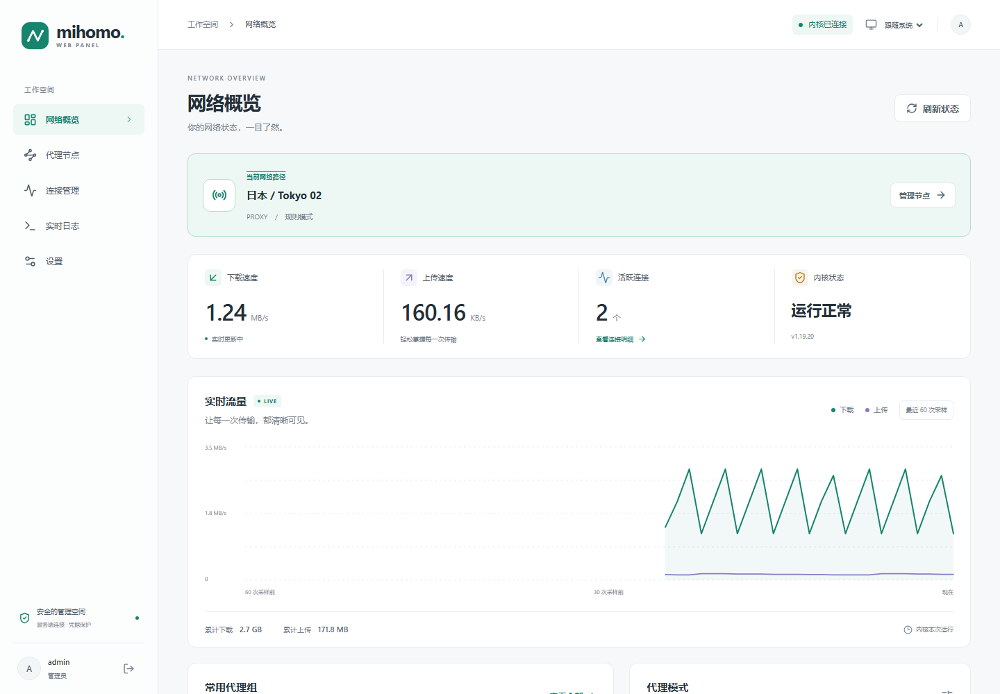
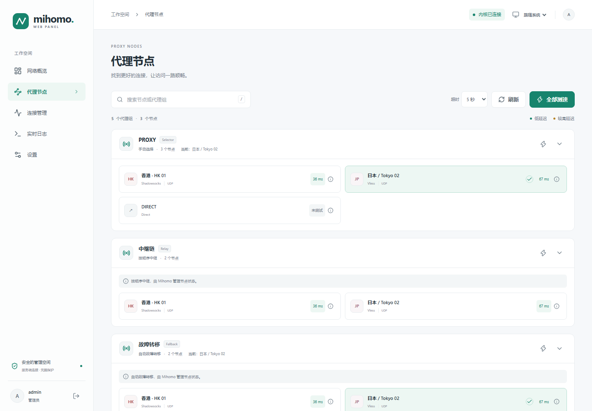

# mihomo-web-panel

[](https://github.com/KaguyaJs/mihomo-web-panel/actions/workflows/ci.yml)
[](https://github.com/KaguyaJs/mihomo-web-panel/releases)
[](LICENSE)

独立的 Mihomo Web 管理平台。Rust 后端负责身份认证、会话管理和 Controller API 调用，Vue 界面嵌入可执行文件，支持桌面和手机访问。提供 Linux、Windows、macOS 的独立二进制版本，运行时无需 Rust、Node.js 或额外的 Web 服务器。

本平台管理**已经安装并运行的 Mihomo**，不包含、不下载、不安装、不启动、不替换 Mihomo 内核。

```text
浏览器 ── HTTPS / IPv6 ── Caddy / Nginx ── mihomo-web-panel
                                                │
                                        身份认证与 API 校验
                                                │
                                  已有 Mihomo Controller（回环 / 可信内网）
```

浏览器仅访问同源 `/api`。保存的 Controller 地址和 Secret 只由服务端使用；节点选择必须获得 Mihomo API 确认。代理功能采用明确路由和响应字段白名单。

## 界面预览

截图来自实际界面，展示自动化测试的 Mock 数据。生产界面读取所配置的 Mihomo 实例。





[手机界面](docs/images/overview-mobile.png)支持底部导航。提供浅色、深色、跟随系统主题及 `prefers-reduced-motion` 适配。

## 功能

- 一次性初始化令牌、Argon2id 密码、服务端 Session、会话轮换和撤销。
- HttpOnly / Secure / SameSite Cookie，Origin / Host / CSRF / CSP 校验，双维登录限流。
- Selector 节点选择、自动代理组状态、搜索、分页、单节点和有界批量测速、延迟历史。
- Rule / Global / Direct 模式，实时流量图、累计流量和共享 WebSocket 上游。
- 连接查询与关闭，实时日志、等级筛选、关键词搜索、暂停和有界缓存。
- 账户、后端连接、服务监听、会话超时和流量刷新频率设置。
- systemd 开机自启控制；主服务非 root，独立 helper 仅允许固定服务的 enable / disable / status。
- IPv4 / IPv6，HTTPS 反向代理，SQLite WAL、事务和编号迁移。

## 下载与直接运行

从 [GitHub Releases](https://github.com/KaguyaJs/mihomo-web-panel/releases/latest) 下载对应平台的发行包，解压后直接运行：

| 平台 | 发行包后缀 | 启动方式 |
| --- | --- | --- |
| Windows x64 | `windows-x86_64.zip` | 双击 `mihomo-web-panel.exe` |
| macOS Apple Silicon | `macos-aarch64.tar.gz` | 双击 `Start.command` 或运行 `./mihomo-web-panel` |
| macOS Intel | `macos-x86_64.tar.gz` | 双击 `Start.command` 或运行 `./mihomo-web-panel` |
| Linux x64 / ARM64 | `linux-x86_64.tar.gz` / `linux-aarch64.tar.gz` | 运行 `./mihomo-web-panel` |

默认使用当前用户的配置和数据目录，监听 `http://127.0.0.1:8787`。首次交互式启动显示一次性初始化令牌，并打开浏览器；填写管理员和已有 Controller 后即可使用。以后启动保留账户和设置。

`--portable` 将配置与数据放在可执行文件旁，`paths` 查看位置，`--no-open` 禁用自动打开浏览器。Windows 最低 Windows 10 / Server 2016，macOS 最低 macOS 13。macOS 使用 ad-hoc 签名，尚未通过 Apple 公证，首次启动可能需要在系统设置中允许。校验、各平台步骤、数据备份和升级见 [直接运行说明](docs/standalone.md)。

## Linux 服务器安装

推荐 Linux、systemd 249+，例如 Debian 12+ 或 Ubuntu 22.04+。从 [GitHub Releases](https://github.com/KaguyaJs/mihomo-web-panel/releases/latest) 下载发布包和 `SHA256SUMS`：

| 服务器架构 | 发布包后缀 |
| --- | --- |
| Intel / AMD 64 位，`uname -m` 为 `x86_64` | `linux-x86_64.tar.gz` |
| ARM64，`uname -m` 为 `aarch64` | `linux-aarch64.tar.gz` |

以下以 `v0.2.0` 和 x86_64 为例：

```bash
curl -fLO https://github.com/KaguyaJs/mihomo-web-panel/releases/download/v0.2.0/mihomo-web-panel-0.2.0-linux-x86_64.tar.gz
curl -fLO https://github.com/KaguyaJs/mihomo-web-panel/releases/download/v0.2.0/SHA256SUMS
```

私有仓库需要相应访问权限，可使用已登录的 GitHub CLI 下载同样的文件：

```bash
gh release download v0.2.0 --repo KaguyaJs/mihomo-web-panel \
  --pattern 'mihomo-web-panel-0.2.0-linux-x86_64.tar.gz' --pattern SHA256SUMS
```

下载后校验并安装：

```bash
sha256sum --ignore-missing -c SHA256SUMS
tar -xzf mihomo-web-panel-0.2.0-linux-x86_64.tar.gz
cd mihomo-web-panel-0.2.0-linux-x86_64
sha256sum -c SHA256SUMS
sudo bash scripts/install.sh --origin https://panel.example.com
sudo systemctl status mihomo-web.service --no-pager
```

将域名替换为实际 HTTPS 入口，在 DNS 添加指向服务器公网 IPv6 的 AAAA 记录。平台默认监听 `127.0.0.1:8787`，由 Caddy 或 Nginx 对外提供 HTTPS。

已有 Mihomo 的 Controller 应只监听回环或可信内网，例如：

```yaml
external-controller: 127.0.0.1:9090
secret: "为现有 Mihomo 设置独立的强随机 Secret"
```

按原有内核维护方式使该配置生效。安装器只安装本平台及专用 helper，不管理内核生命周期。

### HTTPS 与初始化

Caddy 站点配置：

```caddyfile
panel.example.com {
    encode zstd gzip
    reverse_proxy 127.0.0.1:8787
}
```

读取一次性初始化令牌：

```bash
sudo -u mihomo-web /usr/local/bin/mihomo-web-panel \
  --config /etc/mihomo-web/config.toml bootstrap-token
```

访问 HTTPS 入口，设置管理员账户，填写已有 Controller 和 Secret，测试连接成功后完成初始化。令牌消费后立即失效。

公网仅开放 HTTPS 入口及所需的证书验证端口。防火墙和云安全组必须同时覆盖 IPv4、IPv6，内部 8787 和 Controller 9090 不对公网开放。无域名 IPv6 的证书、Caddy 安装和完整防火墙命令见 [部署指南](docs/deployment-guide.md)。

## 开发

要求 Rust 1.92+、Node.js 24 LTS（最新补丁版本）、npm 11+、Python 3.11+ 和平台 C 编译工具链。推荐当前 Rust Stable。仓库包含 Cargo 和 npm 锁文件。

```bash
git clone https://github.com/KaguyaJs/mihomo-web-panel.git
cd mihomo-web-panel
npm --prefix web ci
npm --prefix web run build
cp config.example.toml config.toml
cargo run --locked -- --config config.toml serve
```

另开终端，在仓库根目录读取初始化令牌：

```bash
cargo run --locked -- --config config.toml bootstrap-token
```

开发入口为 `http://127.0.0.1:8787`。Windows 可使用 PowerShell 的 `Copy-Item config.example.toml config.toml`，并安装 MSVC Build Tools。热更新、模块说明和 Linux 构建见 [开发文档](docs/development.md)。

## 测试与发布

```bash
npm --prefix web ci
npm --prefix web run build
npm --prefix web test
cargo fmt --all -- --check
cargo clippy --all-targets --locked -- -D warnings
cargo test --all-targets --locked
cargo build --bins --examples --locked
python3 scripts/check-repository.py
python3 -m unittest discover -s tests/python -v
cd web
npx playwright install chromium
npm run test:e2e
```

CI 检查 Linux、Windows 和 macOS、最低 Rust 版本、浏览器流程、真实独立启动及 systemd 部署。测试使用独立 Mock 和临时数据，不访问真实 Mihomo。

推送与 `Cargo.toml`、前端版本一致的 `vX.Y.Z` 标签，或手动运行 Release 工作流，可以触发测试、五个平台目标的原生构建、实际归档启动校验和 GitHub Releases 发布。发行版包含五个二进制包、完整源码归档及 SHA256 校验文件。流程与重试说明见 [发布文档](docs/releasing.md)。

## 文档与贡献

- [部署指南](docs/deployment-guide.md) · [安装、升级、备份与卸载](docs/installation.md)
- [Windows / macOS / Linux 直接运行](docs/standalone.md)
- [配置](docs/configuration.md) · [架构](docs/architecture.md) · [API](docs/api.md)
- [安全模型](docs/security.md) · [漏洞报告](SECURITY.md)
- [开发](docs/development.md) · [测试与验收](docs/test-report.md) · [发布](docs/releasing.md)
- [故障排查](docs/troubleshooting.md) · [贡献指南](CONTRIBUTING.md) · [更新记录](CHANGELOG.md)

主服务日志使用 `journalctl -u mihomo-web.service` 查看。升级保留配置和数据库，默认卸载保留数据，显式 `--purge` 才删除平台数据。

本项目采用 [MIT](LICENSE) 许可证。依赖声明和许可原文见 [THIRD_PARTY_NOTICES.md](THIRD_PARTY_NOTICES.md)。
