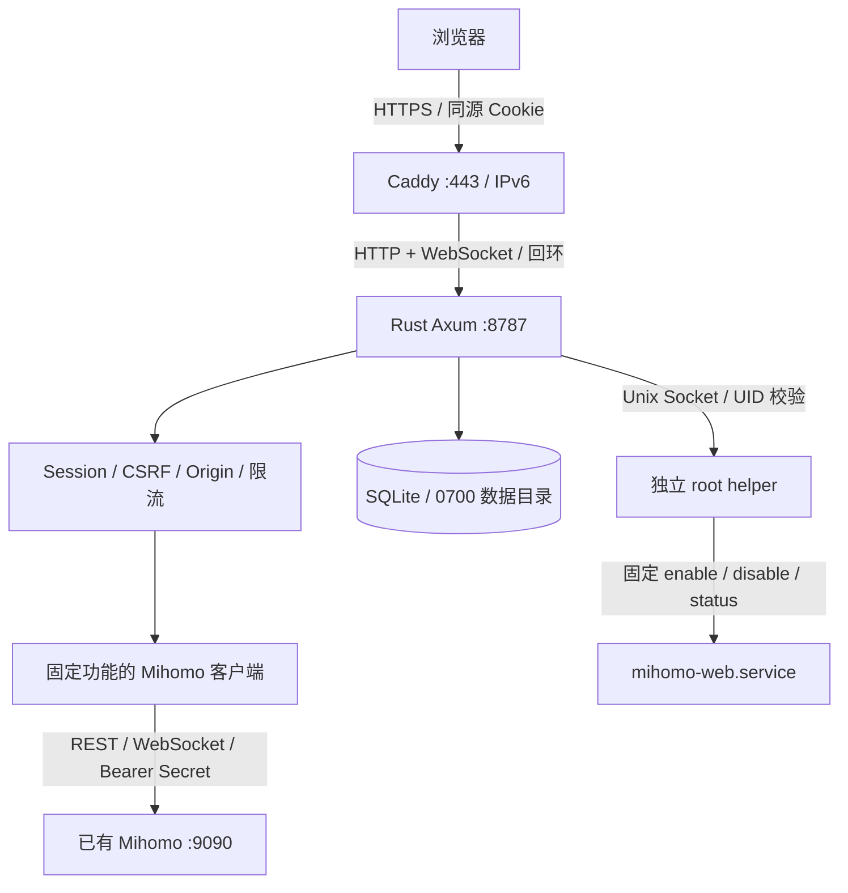

# 架构与边界

项目名为 **mihomo-web-panel**。它管理独立运行的 Mihomo，不携带、不安装、不启动、不替换内核。

## 模块划分

`src/config.rs` 处理本地信任策略和私密文件；`db.rs` 执行 SQLite 迁移和事务；`auth.rs` 实现 Argon2id、摘要 Session、初始化和账户安全；`security.rs` 执行 Origin、Host、CSRF 与两维限流；`mihomo.rs` 负责有界上游请求和响应字段投影；`streams.rs` 复用流量/日志上游连接；`api.rs` 实现公开和受保护路由；`helper.rs` 实现固定协议和最小权限 systemd 操作；`assets.rs` 内嵌前端。

Vue 3 + TypeScript 前端在 `web/`，所有数据来自同源 `/api`。生产资源在 Rust 编译时嵌入，主程序运行无需 Node.js。只有主题偏好存入 localStorage；Cookie 为 HttpOnly；CSRF 保留在内存中。浏览器无法读取保存的 Controller 地址与 Secret，设置页仅允许重新输入。

初始化以单次数据库事务同时创建管理员、保存经验证的后端并消费初始化令牌。没有可抢占账户的独立注册接口。配置保存到 SQLite 事务；监听设置在重启后生效，超时和采样设置动态生效。Session 撤销及过期会关闭已有 WebSocket。

流量与日志分别由一个共享广播源提供。存在订阅者时才连接 Mihomo；最后一个浏览器离开后释放连接。断线指数退避恢复；广播队列、响应体、日志显示与并发测速有固定上限。

默认 Controller 只允许 IP 字面量回环地址。可信私网通过本地 TOML 显式白名单开放，不解析用户提供的域名，不跟随重定向，不读取系统代理变量。测速目标固定在本地配置中，浏览器不能提交任意测试 URL。

## 官方接口依据

- [Mihomo 官方 API 文档](https://wiki.metacubex.one/api/)
- [proxies.go](https://github.com/MetaCubeX/mihomo/blob/Meta/hub/route/proxies.go)：`GET /proxies`、`PUT /proxies/{name}` 请求 `{name}`、`GET /proxies/{name}/delay`。
- [configs.go](https://github.com/MetaCubeX/mihomo/blob/Meta/hub/route/configs.go)：`GET /configs`、`PATCH /configs`。本平台仅投影和修改 `mode`。
- [connections.go](https://github.com/MetaCubeX/mihomo/blob/Meta/hub/route/connections.go)：连接快照与删除接口。
- [server.go](https://github.com/MetaCubeX/mihomo/blob/Meta/hub/route/server.go)：`/version`、`/traffic`、`/logs` 的 WebSocket 协议。

引用记录保存在 `docs/reference/sources.md`，本地原始研究文件位于 `.tools/reference/`，不参与构建或源码发布。测试中的 Mock 遵守这些接口，产品页面不使用 Mock 数据。
